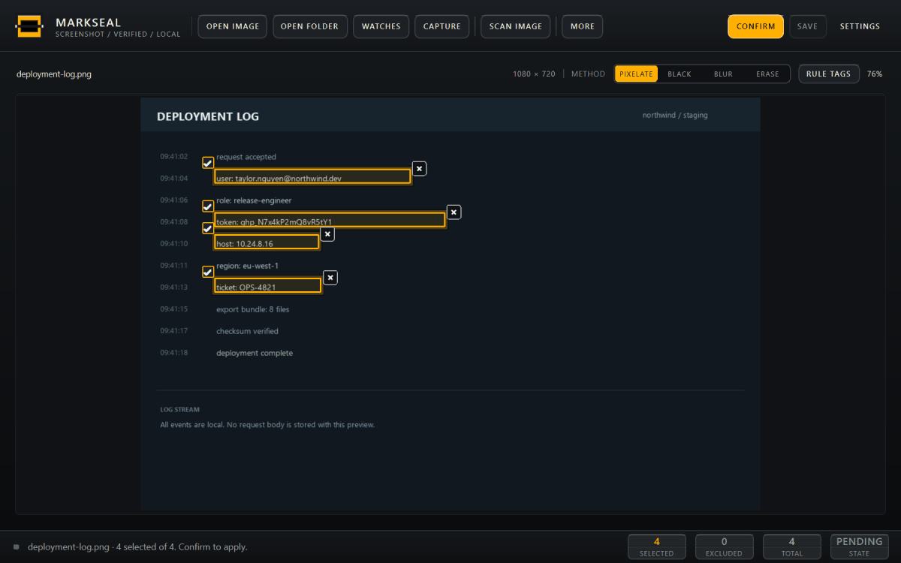
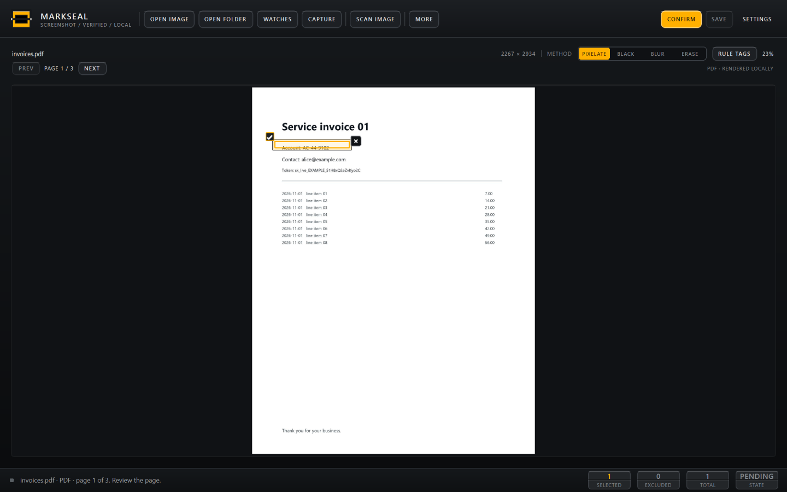
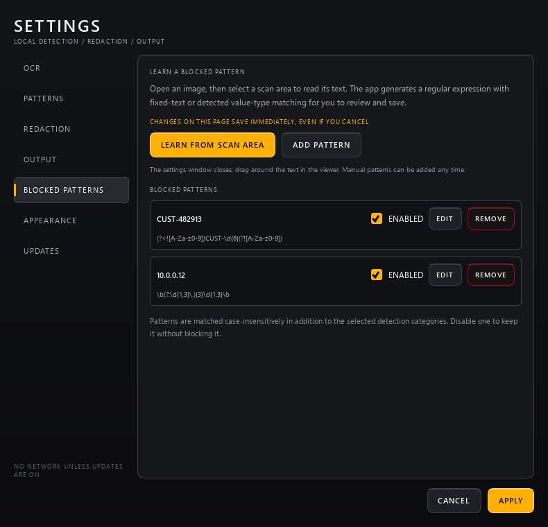
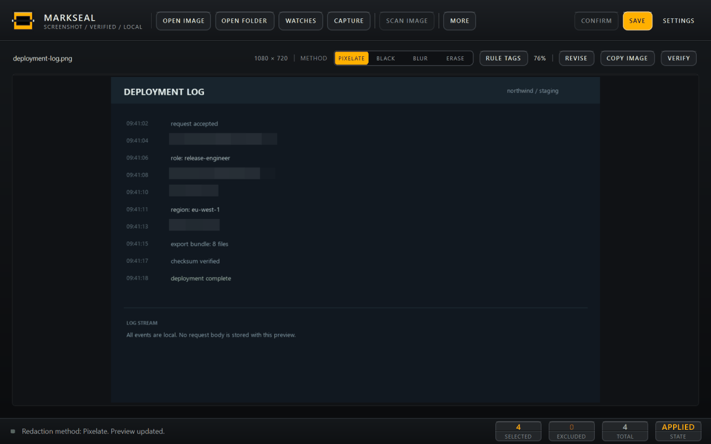
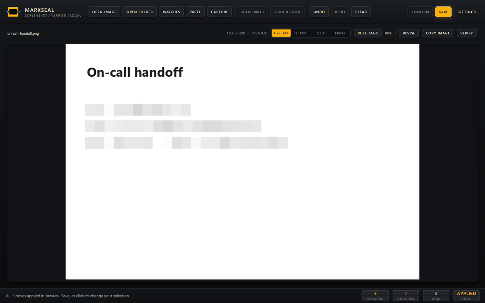
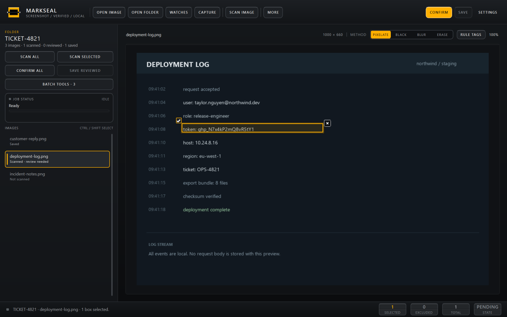
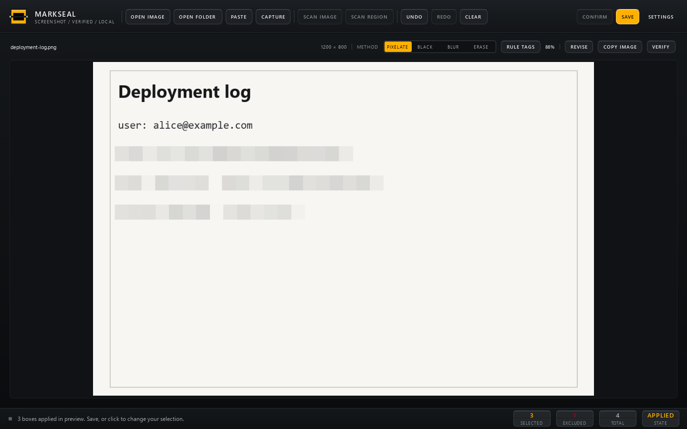

  

  <b>Private, review-first redaction for screenshots and PDFs.</b> 
  Local OCR and a bundled PII model find names, addresses, secrets, cards, and faces. You review every box and export a pixel-accurate PNG with a verifiable audit log. No uploads, accounts, or telemetry.

  
  
  

## Download

| Platform | Build | Notes |
|---|---|---|
| Windows x64 | [Markseal-Setup.exe](https://github.com/rwensel/markseal/releases/latest/download/Markseal-Setup.exe) | Unsigned 2.0.8 preview; no code-signing certificate is currently available, so Windows may show an unknown-publisher warning. |
| Linux x64 | [Markseal-linux-x64.tar.gz](https://github.com/rwensel/markseal/releases/latest/download/Markseal-linux-x64.tar.gz) | Untested PyInstaller build; extract and run `Markseal/Markseal`. |
| macOS arm64 | [Markseal-macos-arm64.zip](https://github.com/rwensel/markseal/releases/latest/download/Markseal-macos-arm64.zip) | Untested, unsigned, not notarized; Gatekeeper needs an override. |

All builds include the local PII model (about 86 MB), so they are larger than 2.0.7. Builds and `SHA256SUMS.txt` are on the [releases page](https://github.com/rwensel/markseal/releases). Or [build from source](docs/building.md).

## See it work

## PDFs, page by page

Open a PDF with **Open image** or drop it on the window. MarkSeal renders the page locally at 200 DPI, then the usual review, OCR, and redaction tools work on the rendered page. Use **PREV** and **NEXT**, or PageUp and PageDown, to move between pages; each page keeps its own boxes and confirmation. **Save** writes the current page as a PNG using a page-specific name, and the coordinate log records `source_page`.

The page is capped at 40 million pixels to keep a very large PDF from exhausting memory. PDFs are opened one file at a time; folder mode remains image-only. Password-protected PDFs, PDF text extraction, and PDF output are not supported yet, and **VERIFY** is unavailable for PDF pages because the export has no image original to compare against.

## Why MarkSeal

- **Your screenshots and PDFs never leave the machine.** OCR, the bundled PII model, pattern matching, PDF rendering, redaction, and export run locally. The only optional network use is the update check, which is off by default.
- **You decide what gets covered.** Suggestions start selected; click to exclude, drag to add, and turn on rule tags to see why each box appeared.
- **The output is verifiable.** Export a PNG plus an optional JSON coordinate log, then check it with the bundled audit tool.

## Features

- Local RapidOCR and a bundled PII model with presets for sharing, work logs, financial details, faces and codes, or everything.
- Local personal-data detection: names and postal addresses from context, plus birth dates and license/ID numbers from field labels.
- Reviewable boxes with include/exclude, rule tags, undo/redo, and keyboard navigation.
- Pixelate, solid black, blur, or erase; pixels outside the selected boxes are preserved.
- Full-image scan, region scan, screen capture, clipboard paste, and drag-and-drop.
- Open PDFs page by page: render locally at 200 DPI, navigate pages, and save the current redacted page as PNG.
- Folder scanning with **Scan all**, **Scan selected**, **Confirm all**, **Save reviewed**, queued/running rows, and cancel.
- Watched folders: register folders once and see new captures in the inbox. Manual watches wait for you; automatic watches scan and export new images while the app runs.
- Bounded parallel jobs: set **1–16 parallel image jobs**; each active worker owns a local OCR engine.
- Box reuse and anchor matching for screenshots with matching or shifted framing.
- **Learn your own identifiers.** Draw a box around a value and save a reusable blocked pattern for the IDs specific to your team.
- Six themes, including Split-flap Concourse and Midnight Transit Diagram.
- Optional update check and beta channel; nothing installs without a click.

## How it works

1. **Open** an image, paste it, or capture a region.
2. **Scan** and review the suggested boxes; include, exclude, or draw your own.
3. **Confirm**, then save or copy the redacted PNG.

## Teach it your own patterns

The built-in detectors cover common personal and engineering identifiers. MarkSeal can also learn your team's own identifiers from a scan area: an internal customer ID, a device serial, or an account code.

Open an image, go to **Settings → Blocked patterns**, and click **Learn from scan area**. Drag a tight box around one example. MarkSeal reads that area locally, shows the recognized text and a generated regular expression, and lets you choose fixed-text matching or a detected value class such as IPv4/IPv6, CIDR, UUID, email, URL, MAC, ISO date, integer, or long hex token. Review it, name it, and save; every future scan includes it. Nothing leaves the machine.

## Methods and themes

### Four ways to redact

Pixelate, solid black, blur, or erase. Switch on the live preview to see exactly what will be saved.

### Six themes

From the default Split-flap Concourse to Railway Timetable Rack, Jet-age Ticket Wallet, Centre-rail Reference, Crouwel Grid Specimen, and Midnight Transit Diagram.

## Batch without the busywork

Open a folder, scan all or only the rows you select, confirm in bulk, and save every reviewed image. Rows show queued, running, saved, and partial states; **Cancel scan** stops queued work while keeping completed results.

Concurrency is yours to tune: **Settings → OCR → Parallel image jobs** accepts 1–16 images at once. Each active worker owns a local OCR engine, so higher values finish faster on a large machine but use more CPU and memory. The app uses a bounded worker pool, and the scan banner reports how many workers are active.

## Watch folders

Register the folders where your screenshots pile up, and new captures arrive in the app instead of waiting to be found. MarkSeal sweeps each watched folder when it starts and keeps watching while it runs. There is no tray icon, autostart entry, or background service.

Add a folder in **Settings → Watched folders**, or open the inbox with **WATCHES** and choose **Add folder**. A new watch starts as MANUAL, and the files already in the folder are recorded without being processed.

- **MANUAL**: new images wait in the inbox. Opening the folder adds them to the review board and scans them; the usual review, confirm, and save steps follow.
- **AUTO**: new images are scanned and, when the scan is complete and finds at least one box, confirmed and exported. Exports go to a `redacted` subfolder beside the originals, using the current method and filename template. The coordinate log follows the **Coordinate log** setting. Every automatic export keeps its intake record, including the export path.

Automatic work never overwrites an export. A partial scan, a scan that finds nothing, a filename collision, or a read error stops processing that file and marks it for review; nothing is exported. The inbox shows the reason, and opening the folder hands the file to the normal review flow.

**PROCESS EXISTING (N)** is a deliberate action. For an automatic watch it marks the files recorded when the watch was added, along with any waiting for review, for automatic processing. For a manual watch it makes those files count as new, so the next folder open scans them.

**STOP** appears while automatic work runs. It stops the remaining files and keeps everything already finished. Automatic processing stays paused until you choose **PROCESS EXISTING** or switch the watch back to **AUTO**. The row shows how many files are waiting.

Limits worth knowing:

- MarkSeal must be running. Closing the app pauses every watch.
- A watch covers PNG, JPEG, BMP, and TIFF images directly inside the folder. PDFs and subfolders are not included.
- Automatic export is review after the fact, not a guarantee. The scan must finish cleanly and find at least one box, but detection can still miss something sensitive. Review exported copies before sharing them, or use MANUAL for material that needs a person first.
- A tool that overwrites one filename exports its first version, then sends later versions to review as collisions.
- The original is never modified.
- A watched folder that disappears keeps its row and records until it returns. Two app instances watching the same folder race; the second reports a collision.
- MarkSeal ignores the export copies it recorded and their sidecars, so a watch does not loop on its output.
- A single-image **SAVE** you direct into a watched folder is treated as a new source image on the next sweep. Only recorded export copies are skipped.

## Screenshots

| Review suggestions | Applied preview |
|---|---|
|  |  |

## Documentation

- [Getting started](docs/getting-started.md): install, open, scan, review, save.
- [Reviewing and redacting](docs/reviewing.md): boxes, rules, zoom, capture, folders, the inbox, reuse.
- [Settings](docs/settings.md): OCR, presets, personal fields, blocked patterns, watched folders, output, themes, updates.
- [Building from source](docs/building.md): local builds, tests, notices, releases.
- [Privacy](PRIVACY.md): what stays on the machine.
- [Third-party notices](THIRD_PARTY_NOTICES.txt): bundled components and licenses.

## Privacy and security

MarkSeal has no telemetry, accounts, or upload integrations. The PII model and OCR run locally; recognized text never leaves the machine. The app reads the images you open, images in folders you ask it to watch, the files it exports, and its local settings and watch list. The optional update check exchanges release metadata and the installer, never image data. See [Privacy](PRIVACY.md) for the full statement.

## Contributing

Bug reports and feature ideas are welcome in [Issues](https://github.com/rwensel/markseal/issues). For code changes, keep the app offline, run the test suite, and see [Building from source](docs/building.md).

If MarkSeal saves you a cleanup pass, a star helps other people find it.

## License

MIT. See [LICENSE](LICENSE). Third-party components and their licenses are listed in [THIRD_PARTY_NOTICES.txt](THIRD_PARTY_NOTICES.txt) and under **Settings → Updates → Third-party licenses**.
