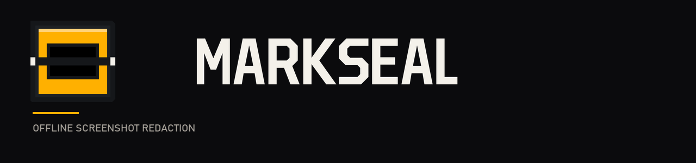
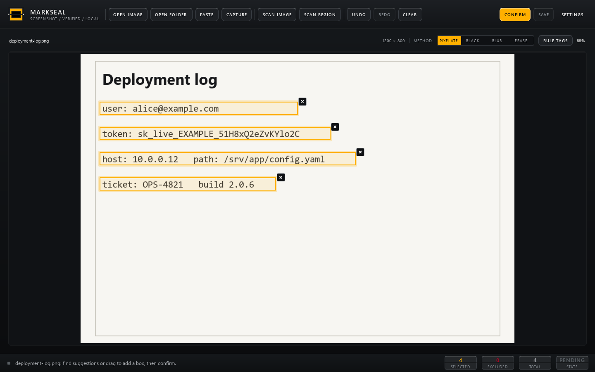

  

  <b>Find and redact sensitive text in screenshots without uploading them.</b> 
  Local OCR suggests likely secrets, you review the boxes, and export a pixel-accurate PNG.

  
  
  

## Download

| Platform | Build | Notes |
|---|---|---|
| Windows x64 | [Markseal-Setup.exe](https://github.com/rwensel/markseal/releases/latest/download/Markseal-Setup.exe) | Unsigned 2.0.6 preview; signing is provided by the [SignPath Foundation](https://signpath.org/) once approved. |
| Linux x64 | [Markseal-linux-x64.tar.gz](https://github.com/rwensel/markseal/releases/latest/download/Markseal-linux-x64.tar.gz) | Untested PyInstaller build; extract and run `Markseal/Markseal`. |
| macOS arm64 | [Markseal-macos-arm64.zip](https://github.com/rwensel/markseal/releases/latest/download/Markseal-macos-arm64.zip) | Untested, unsigned, not notarized; Gatekeeper needs an override. |

All builds and `SHA256SUMS.txt` are on the [releases page](https://github.com/rwensel/markseal/releases). Or [build from source](docs/building.md).

## See it work

## Why MarkSeal

- **Your screenshots never leave the machine.** OCR, pattern matching, redaction, and export run locally. The only optional network use is the update check, which is off by default.
- **You decide what gets covered.** Suggestions start selected; click to exclude, drag to add, and turn on rule tags to see why each box appeared.
- **The output is verifiable.** Export a PNG plus an optional JSON coordinate log, then check it with the bundled audit tool.

## Features

- Local RapidOCR with presets for sharing, work logs, financial details, faces and codes, or everything.
- Reviewable boxes with include/exclude, rule tags, undo/redo, and keyboard navigation.
- Pixelate, solid black, blur, or erase; pixels outside the selected boxes are preserved.
- Full-image scan, region scan, screen capture, clipboard paste, and drag-and-drop.
- Folder scanning, batch confirm/export, box reuse, and anchor matching for shifted screenshots.
- Six themes, from Split-flap Concourse to Midnight Transit Diagram.
- Optional update check and beta channel; nothing installs without a click.

## How it works

1. **Open** an image, paste it, or capture a region.
2. **Scan** and review the suggested boxes; include, exclude, or draw your own.
3. **Confirm**, then save or copy the redacted PNG.

## Screenshots

| Review suggestions | Applied preview |
|---|---|
|  |  |

## Documentation

- [Getting started](docs/getting-started.md) — install, open, scan, review, save.
- [Reviewing and redacting](docs/reviewing.md) — boxes, rules, zoom, capture, folders, reuse.
- [Settings](docs/settings.md) — OCR, presets, blocked patterns, output, themes, updates.
- [Building from source](docs/building.md) — local builds, tests, notices.
- [Privacy](PRIVACY.md) — what stays on the machine.
- [Third-party notices](THIRD_PARTY_NOTICES.txt) — bundled components and licenses.

## Privacy and security

MarkSeal has no telemetry, accounts, or upload integrations. The app reads the images you open, the files you export, and its local settings. The optional update check exchanges release metadata and the installer, never image data. See [Privacy](PRIVACY.md) for the full statement.

## License

MIT. See [LICENSE](LICENSE). Third-party components and their licenses are listed in [THIRD_PARTY_NOTICES.txt](THIRD_PARTY_NOTICES.txt) and under **Settings → Updates → Third-party licenses**.
