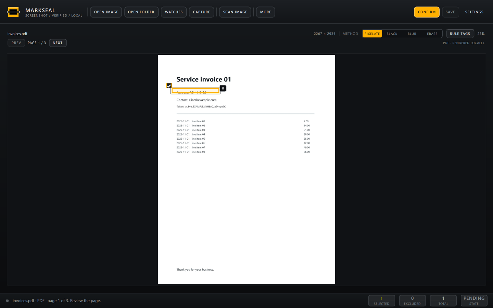

# Getting started

## Install

Download the build for your platform from the [latest release](https://github.com/rwensel/markseal/releases/latest):

- **Windows x64:** `Markseal-Setup.exe`. The 2.4.0 build is unsigned; no code-signing certificate is currently available, so Windows may show an unknown-publisher warning.
- **Linux x64:** `Markseal-linux-x64.tar.gz`. Extract it and run `Markseal/Markseal`. This build is untested.
- **macOS arm64:** `Markseal-macos-arm64.zip`. It contains `MarkSeal.app`; the build is untested, unsigned, and not notarized, so Gatekeeper requires an override.

Updates are opt-in and off by default.

## Run from source

Python 3.10 or newer is required.

```powershell
python -m venv .venv
.venv\Scripts\python.exe -m pip install -e .
.\launch.bat
```

On Linux or macOS, use `.venv/bin/python` for the install and run `.venv/bin/markseal`. The app makes no network calls by default; only the opt-in update check contacts the update feed, and image data never leaves the machine.

Personal-data detection also needs the bundled PII model. Release installers include it; a source checkout fetches it once with `.venv\Scripts\python.exe packaging\fetch_ner_model.py` (or `.venv/bin/python packaging/fetch_ner_model.py`). Without it, the personal-field categories produce no suggestions.

## Open a screenshot or PDF

Use **Open image**, paste with Ctrl+V, or drag an image anywhere onto the window. Dragging a folder opens folder mode. A copied image or a copied image file works with paste.

MarkSeal opens PNG, JPEG, BMP, and TIFF images, plus PDF documents. A PDF opens one file at a time; use the page bar to move between pages. Folder mode remains image-only.

## Open a PDF

The PDF page bar sits under the filename. **PREV** and **NEXT** (PageUp and PageDown) move through the document; the label shows `PAGE n / N`. Each page keeps its own boxes, rules, and confirmation while you move around. Saving writes the current page as a PNG named like `document_page-001_redacted.png`, and the coordinate log includes `source_page`.

PDFs render locally at 200 DPI, capped at 40 million pixels. There is no PDF text extraction, PDF output, password entry, or PDF support in folder mode. **VERIFY** is unavailable for a PDF page because there is no image original to compare against.



## Scan and review

1. Click **Scan image**. The banner above the screenshot shows the OCR stage and progress while the rest of the window stays responsive.
2. Suggestions start selected. Click a box to exclude it, click again to include it, or press Delete / click the X to remove it.
3. Drag on the image to add a manual box. If you need only a small area, open **More** and choose **Scan a region**.
4. Turn on **Rule tags** in the viewer caption to see why a box was suggested. The tags are review-only and are never exported.
5. Press **Confirm** to apply the selected boxes to the preview. **Revise** brings the outlines back if you need to change the selection.

The default **Share a screenshot** preset includes names, addresses, birth dates, and license/ID numbers. Names and addresses are suggestions from local context; birth dates and license/ID numbers come from field labels. Review them like any other box. On the first scan that enables personal fields, the bundled PII model loads and the banner reports it.

The bottom signal board always shows selected, excluded, and total counts, plus whether the preview is applied or pending.

If a value keeps slipping through, teach it once: select it with **Settings → Blocked patterns → Learn from scan area** and save the generated expression. See [Blocked patterns](settings.md#blocked-patterns).

## Save and share

After confirming:

- **Save** writes a PNG and, when enabled in Settings, a JSON coordinate log. The original image is never overwritten.
- For a PDF, **Save** writes only the current rendered page and uses a page-specific PNG name; the log records `source_page`.
- **Copy image** puts the confirmed preview on the clipboard.
- **Save reviewed** in folder mode exports every reviewed image that is still awaiting export.

Only selected boxes are applied and included in the log. Review the log before sharing it: it contains the source filename and coordinates.

## Keyboard

| Shortcut | Action |
|---|---|
| Ctrl+O / Ctrl+Shift+O | Open an image or PDF / folder |
| PageUp / PageDown | Previous / next PDF page |
| Ctrl+V | Paste an image |
| Ctrl+F | Scan the current image |
| Ctrl+Enter | Confirm the current selection |
| Ctrl+S | Save a confirmed image |
| Ctrl+C | Copy the confirmed image |
| Ctrl+Z / Ctrl+Shift+Z / Ctrl+Y | Undo / redo the last added box |
| Ctrl+A / Ctrl+Shift+A | Select all / clear the selection |
| Ctrl+= / Ctrl+- / Ctrl+0 | Zoom in / out / fit |
| Shift+arrows | Pan while zoomed |
| Space | Include or exclude the focused box |
| Delete | Remove the focused box |
| Esc | Cancel an area or anchor drag |
| Alt+M | Open the More menu |

Tab reaches the toolbar, then the viewer. With the viewer focused, arrow keys move between boxes.

## If something fails

A scan, copy, or save failure appears in a banner above the signal board with **Retry**, **Logs**, and **Dismiss**. Native dialogs remain for file pickers and confirmations.

Next: [Reviewing and redacting](reviewing.md) · [Settings](settings.md)
