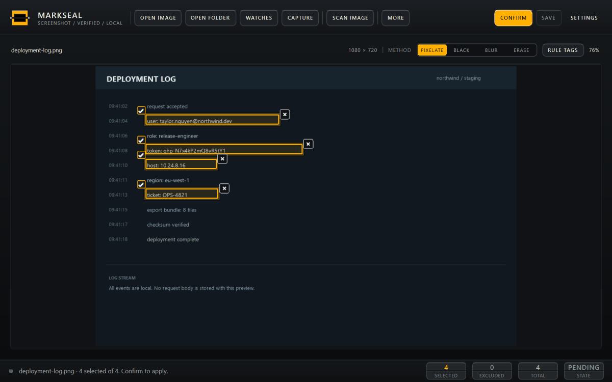

# MarkSeal documentation

MarkSeal finds likely sensitive text in screenshots with local OCR, lets you review the redaction boxes, and exports a pixel-accurate PNG. Everything runs on your machine; the only optional network use is the update check.

- [Getting started](getting-started.md) — install, open, scan, review, save.
- [Reviewing and redacting](reviewing.md) — boxes, rules, zoom, capture, folder work, reuse.
- [Settings](settings.md) — OCR, presets, blocked patterns, output, themes, updates.
- [Building from source](building.md) — local builds and the installer.
- [Privacy](../PRIVACY.md) — what stays on the machine.
- [Third-party notices](../THIRD_PARTY_NOTICES.txt) — bundled components and licenses.

