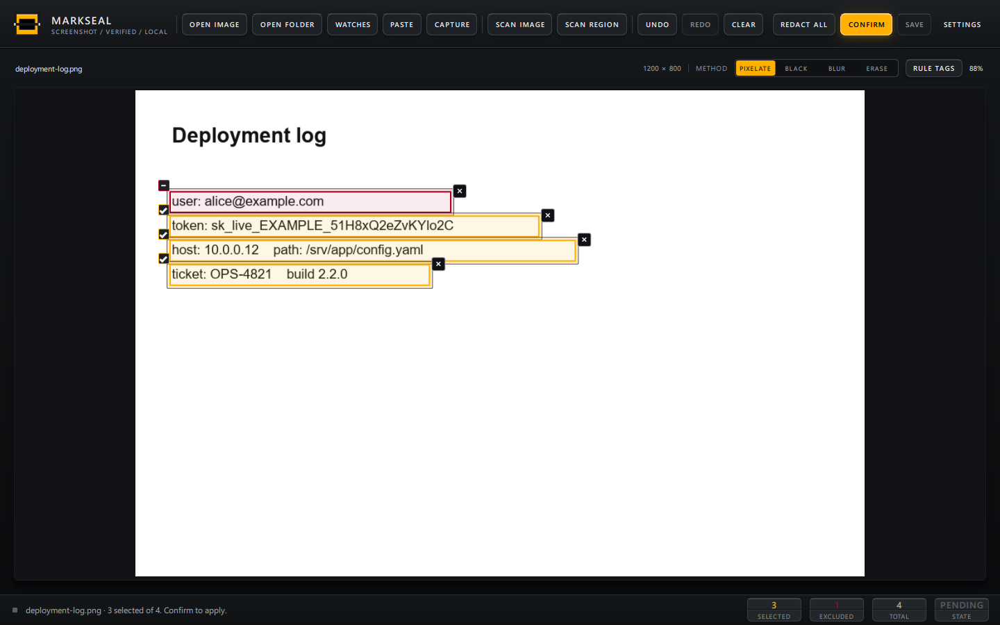
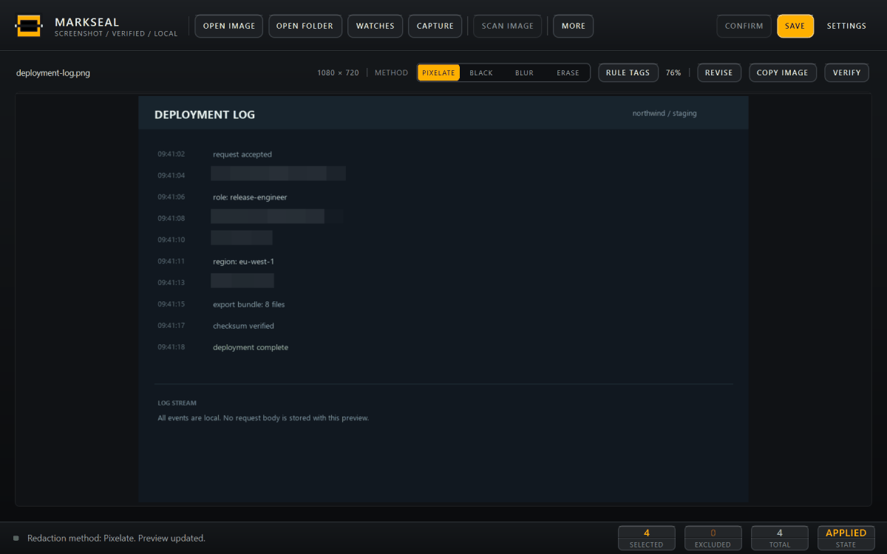
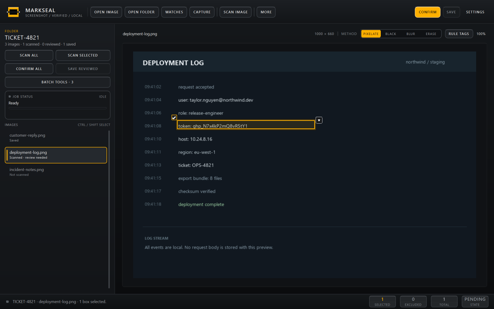

# Reviewing and redacting

## Boxes and selection

Suggestions start selected. The theme accent marks selected boxes and the primary action; the stop color marks excluded boxes (amber and red in the default Split-flap theme). Selected boxes carry a check mark, excluded boxes a dash, and a dark keyline keeps the boundary visible on light screenshots.

- Click a box to exclude it; click again to include it.
- Click the X at a box's upper-right corner, or press Delete with the viewer focused, to remove it.
- Drag to draw a manual box. It starts selected.
- Boxes fully inside an already selected area are dropped, so the outer selected boundary wins and nested duplicates do not stack. This applies to scan suggestions and to copied or matched boxes.
- If boxes overlap, clicking affects the topmost one.



## Rule tags

Turn on **Rule tags** in the viewer caption to inspect attribution. Hover a box, or select exactly one, to see its rule tag. The tag names the detection category, blocked pattern, or provenance such as Manual box, Copied box, or Anchor match. The choice is remembered across restarts. Tags are review-only and are never included in the exported image or coordinate log.

## Zoom and pan

Use the mouse wheel over the image to zoom around the pointer. Right-click and drag to pan while zoomed in. Zoom does not change the saved image. The caption shows the current percentage; the tooltip lists the keyboard shortcuts.

## Scan a region

For small text missed by a full-image scan, zoom in, open **More**, choose **Scan a region**, and drag tightly around the text. A banner names the active mode and offers **Cancel**; Esc also cancels. The app scans an enlarged copy of the selected original pixels and adds boxes to the original image. A narrow region is treated as a single text line. An area scan does not mark the full image as scanned.

## Capture a region

Click **CAPTURE** in the toolbar to dim the screen and drag a rectangle. On release the selected region is loaded as an in-memory image you can scan, review, and save like any other screenshot. Nothing is written to disk until you save. Press Esc to cancel.

## Redaction method

Use the **Method** toggle in the viewer caption, or **Settings → Redaction**, to switch between Pixelate, Black, Blur, and Erase. The choice is saved immediately and applies to the confirmed preview, the copied image, and the saved PNG. The method applies across the folder and is remembered across restarts. Changing it returns reviewed folder images to review before export.

Pixels outside selected rectangles are preserved. Camera metadata is omitted from saved copies.



## Pixelation warning

Pixelation changes only the marked rectangles, using coarse blocks, but it can leave text or visual features recognizable or recoverable. Gaussian **Blur** is similar: blurred text can sometimes be recovered. For highly sensitive material use **Solid black**, and independently review before sharing. **Erase** fills the area with nearby pixels; check the result. This tool cannot guarantee removal of all sensitive information.

## PDF pages

Open a PDF with **Open image** or by dropping it on the window. The page bar under the filename shows **PREV**, `PAGE n / N`, and **NEXT**; PageUp and PageDown do the same from the keyboard. Each page keeps its own boxes, rules, and confirmation while you switch.

Only the current page is saved, as `document_page-001_redacted.png`; the coordinate log records `source_page`. PDFs render locally at 200 DPI and are capped at 40 million pixels. There is no PDF text extraction, PDF output, password entry, or PDF support in folder mode. **VERIFY** is unavailable for PDF pages because the audit compares against an image original.

## Work through a folder

1. Use **Open folder** to list supported images directly inside a folder. PDFs are opened one file at a time; folder mode does not expand their pages. Select a row to switch images and keep its boxes and selections for the session.
2. Use **Scan all** for the remaining images, or **Scan image** for the current one. Ctrl-click selects separate rows and Shift-click selects a range; **Scan selected** scans just those rows and keeps existing boxes. Progress, queued/running labels, and counts stay visible while jobs run.
3. Inspect each image, adjust its boxes, and click **Confirm**. **Confirm all** confirms every eligible image; it skips images with no selected boxes or errors. Partial scans require acknowledging the warning.
4. **Save reviewed** exports every reviewed image still awaiting export. Exports use PNG and refuse to overwrite existing files. A reviewed image with no selected boxes needs a separate confirmation before exporting an unredacted copy.
5. **Cancel scan** stops OCR and keeps completed results; **Scan all** continues with images that still need scanning.

Folder review status and markings last for the current session. Image files and optional logs are saved to disk. **Batch tools** holds Rescan all, Copy boxes to matching, and Match by anchor, with a count of how many can run now.



## Watched folders and the inbox

**WATCHES** in the toolbar opens the inbox and shows a count when new files have arrived. Escape or **Close** dismisses it.

Each row shows the **MANUAL** or **AUTO** badge, the folder path, and the counts for new or changed files, files waiting for automatic processing, files that need review, ready files, and auto-redacted copies. Up to five review reasons follow, such as `shot 7.png · Nothing found`. **Open** closes the inbox and opens the folder in the review board. **Process existing (N)** appears when there are baseline, review, or waiting records.

Ready counts files that were in the folder when the watch was added. They are not processed automatically, and a manual watch also marks new arrivals as ready when you open its folder. When you turn on **Include subfolders**, the nested files present at that moment count as ready.

Opening a MANUAL watch appends unseen images to the bottom of the folder list and scans them. The active row and your selection do not move. For a watch with **Include subfolders** on, the list shows nested images with their relative paths, such as `2026/11/shot.png`. A manual save writes to that watch's `redacted` subfolder, repeating the source's subfolders when the watch includes them.

Opening an AUTO watch pauses new automatic work for that folder. New images are appended and scanned like a manual folder, so you can review or save them by hand; anything still unsaved is processed automatically after you close the folder.

Automatic review failures wait in the inbox. A partial scan, a scan that finds nothing, a filename collision, or a read error becomes a review item with its reason and no export. Open the folder, inspect the image, and save a reviewed copy yourself.

Automatic exports still leave an audit trail: the watch records each export, and the coordinate log sits beside the PNG when that setting is on. A watch with **Include subfolders** on repeats the source's subfolders under `redacted`. The auto-redacted count includes only exports that still exist on disk. A file interrupted mid-run is picked up on the next launch. A single-image **Save** you direct into a watched folder becomes a new source for intake; only recorded export copies are skipped.

The footer holds **Add folder**, the automatic progress line, and **Stop** while automatic work runs. Stop ends the current work and keeps finished exports; automatic processing stays paused until you choose **Process existing** or switch the watch back to **AUTO**.

## Reuse fixed redaction areas

Draw or select the boxes for recurring areas on one image and click **Copy boxes to matching**. The app applies those rectangles at the same pixel coordinates on every other image with matching dimensions; existing boxes stay. Affected images need review before export. Use this when the framing and layout match, and check alignment before saving.

For images that shift slightly, select the boxes and click **Match by anchor**, then drag a rectangle around a distinctive, stable visual cue near them, such as a logo or label. The app searches the other photos locally and moves and scales the boxes relative to the match. It skips uncertain matches, competing repeated cues, and placements outside the image. Strong perspective changes, rotation, or layout changes may require manual placement.

## Audit exports

```powershell
.venv\Scripts\python.exe -m markseal.audit_exports "originals-folder" "export-folder"
```

The audit checks for unreadable PNGs, missing coordinate logs, changed pixels outside the logged rectangles, and wide boxes that warrant review. Add `--ocr` to compare a local RapidOCR identifier pass against the masks and look for readable matches in the exported images; add `--use-app-pattern` with `--ocr` to include the enabled blocked patterns. The four personal-field categories are excluded from this pass, so the audit does not load the PII model. These are review candidates, not proof: visual review is still needed for readable identifiers OCR missed and for ordinary text under an oversized mask.

## Sharing

**Copy image** puts the confirmed preview on the local clipboard so you can paste it into chat, a ticket, documentation, or a sharing service you already use. **Save** writes a PNG and, when enabled, a coordinate log. For a PDF, Save writes the current page and its page-specific log entry. MarkSeal has no upload integrations; sharing happens through your own clipboard or file workflow. Closing MarkSeal with unsaved review work asks before discarding it.
