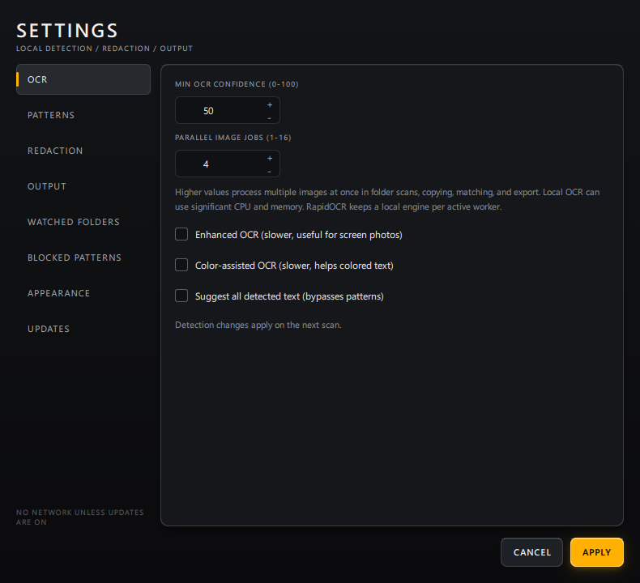
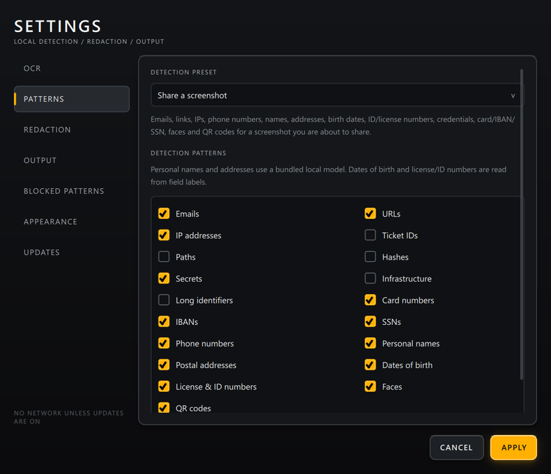
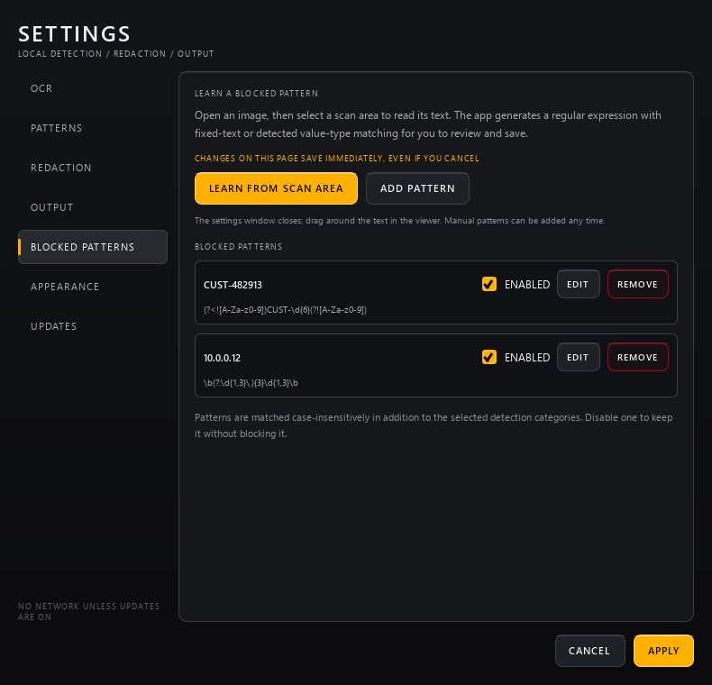
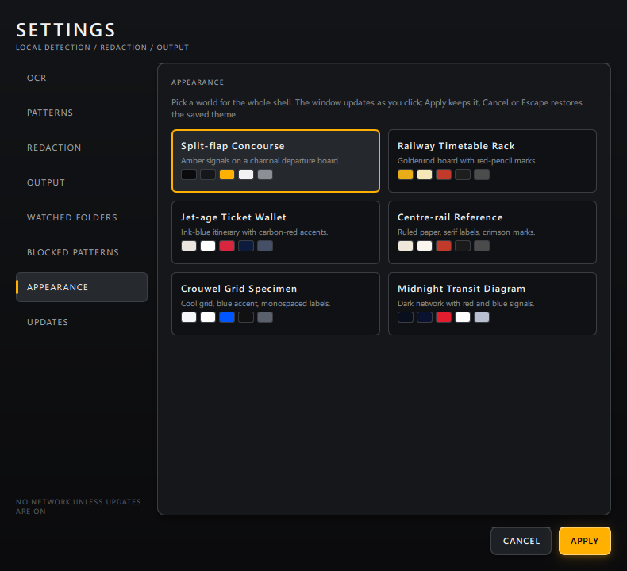
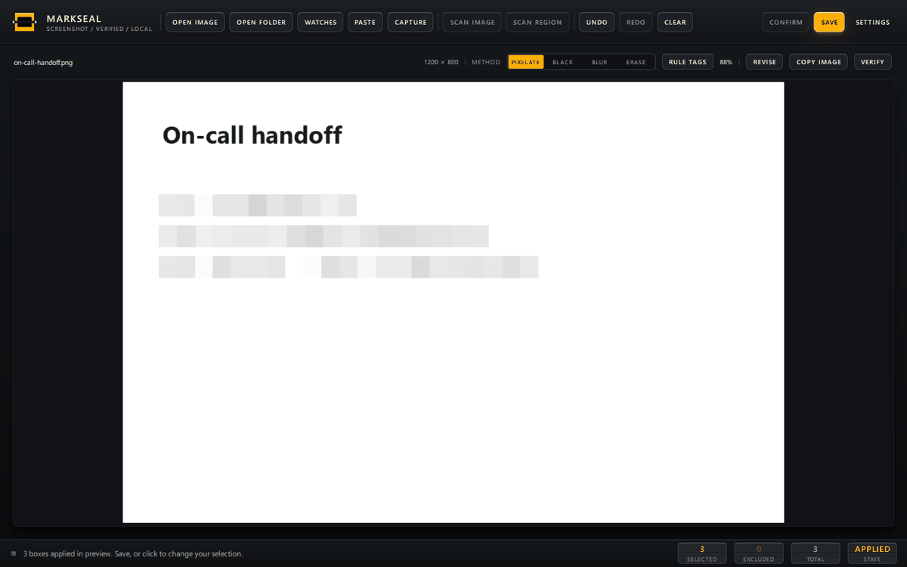

# Settings

Settings open in a separate window. **Apply** saves preferences; Cancel, Escape, or closing the window discards edits. Blocked-pattern changes save immediately. Preferences are stored locally.

## OCR

- **Min OCR confidence** (0–100) filters individual recognized words. It measures text-recognition confidence, not the probability that content is sensitive. A higher threshold reduces noise but can hide faint text.
- **Suggest all detected text** bypasses pattern filtering and marks every word above the threshold. It also skips personal detection because every word is already suggested.
- **Enhanced OCR** adds noise reduction, contrast adjustment, and a different layout pass. It is slower and can recover text from photos of screens.
- **Color-assisted OCR** adds a local-contrast pass and up to two color-contrast passes, including a strikethrough-reduced copy. Extra versions exist only in memory and use the original coordinates.
- **Parallel image jobs** controls how many images a batch scan, copy, match, or export handles at once. Higher values use more CPU and memory; RapidOCR keeps an engine per active worker. The batch runner uses a bounded worker pool.

Extra passes use copies capped at 2400 pixels on the longest side and share a 35-second budget. Once spent, remaining passes are skipped and the image is marked as a partial scan; a pass that already started is not interrupted. Review partial scans before confirming.

## Detection presets and patterns

**Detection preset** chooses a starting set of categories. Changing the preset resets the type checkboxes but keeps blocked patterns.

| Preset | Categories |
|---|---|
| Share a screenshot | Emails, URLs, IP addresses, phone numbers, names, addresses, birth dates, license/ID numbers, secrets, card numbers, IBANs, SSNs, faces, QR codes |
| Work logs & configs | Emails, URLs, IPs, ticket IDs, paths, hashes, secrets, infrastructure, long identifiers |
| Financial details | Emails, card numbers, IBANs, SSNs, names, addresses, birth dates |
| Faces & codes | Faces, QR codes |
| Everything | All text and image categories |

The personal-field categories use a bundled GLiNER PII Small int8 model (the model artifact is about 83 MB; about 86 MB with its tokenizer and manifest). It runs locally and loads on the first scan that enables **Personal names** or **Postal addresses**. The model reads the OCR text from the image; no text or image is sent anywhere. The model is installed with the app and is never downloaded at runtime.

**Dates of birth** and **License & ID numbers** are read deterministically from field labels such as `DOB`, `Date of Birth`, `License No.`, `Passport No.`, and `ID No.`; the same labels reinforce labeled names and addresses. Thresholds favor precision: a name or address must clear the model's confidence threshold, a license/ID value needs at least four alphanumerics including a digit, and a birth date needs a date shape. OCR words below the minimum OCR confidence cannot appear inside a suggestion.

The shipped model is English-only. A name or address with no surrounding context or label can be missed, and unusual license or passport formats and label variants outside the field vocabulary can be missed. Detection remains a starting point.

Phone numbers require separators; a bare 10-digit sequence is not matched. Card numbers use Luhn, IBANs use MOD-97, and SSNs require the dashed US format. With Secrets enabled, credential labels such as Password or Bearer token also match the neighboring value on the same visual row.

Patterns are matched case-insensitively. **Suggest all detected text** bypasses category filtering and skips personal detection.

## Blocked patterns

Blocked patterns cover identifiers unique to your team: a customer number format, a device serial prefix, an internal account code. Teach one example and MarkSeal catches the rest.

Open **Settings → Blocked patterns** and click **Learn from scan area**. The Settings window closes and the viewer asks for a tight box around the text. The app reads that area locally and shows the recognized text and an editable regular expression.

If the text is a single recognizable value, choose a **Match type**: fixed text or a detected value class such as IPv4/IPv6 address, CIDR range, integer, UUID, email, URL, MAC address, ISO date, or long hex token. Fixed text is the default; changing the type updates the expression, which stays editable. Use **Add pattern** for a manual expression; the label is optional. Edit a saved row to rename it, or disable/remove it from the same tab. Changes save immediately.

For short codes inside underscore-separated names, use alphanumeric boundaries such as `(?<![A-Za-z0-9])(?:abc|xyz)(?![A-Za-z0-9])`; `\b` treats underscores as word characters. Infrastructure detection also covers environment-qualified names such as `ABC_PROD_MOBILE`; bare merge-request numbers such as `!42` are left alone unless a blocked pattern matches them.

## Redaction

The **Method** toggle in the viewer caption and **Settings → Redaction** share the same choice: Pixelate, Black, Blur, or Erase. It is saved immediately and applies to the preview, copied image, and PNG. Solid black is the safest choice for highly sensitive material; pixelation and blur can leave recoverable detail. See [Reviewing and redacting](reviewing.md#pixelation-warning).

## Output

- **Output folder** defaults to a `redacted` subfolder beside the input image.
- **Filename template** defaults to `{stem}_redacted.png`. Use `{stem}`, `{ext}`, and `{index}`; for example, `reviewed_{index:03d}` gives `reviewed_001.png`.
- **Coordinate log** writes a JSON file describing the source filename and selected rectangles. Inspect it before sharing.
- **Performance logs** writes local JSONL traces with timings, gaps, counts, and error types. Traces omit filenames, paths, OCR text, and blocked-pattern expressions.

Exports use PNG and refuse to overwrite existing files. A reviewed image with no selected boxes requires a separate confirmation before exporting an unredacted copy.

Run `.venv\Scripts\python.exe -m markseal.performance_log` to summarize the latest trace, or pass a trace path. It reports mean and 95th-percentile timings and, for OCR runs, how many new suggestions each pass contributed. Pass timings include nested stages, so do not add them together.

## Appearance

Choose one of six themes: Split-flap Concourse (default), Railway Timetable Rack, Jet-age Ticket Wallet, Centre-rail Reference, Crouwel Grid Specimen, and Midnight Transit Diagram. Clicking a card previews it across the window; **Apply** keeps it. The bottom status line names the current theme's selected and excluded colors. No network calls are involved.

## Updates

Updates are off by default. **Settings → Updates** has three switches:

- **Check for updates** enables the update check.
- **Download updates automatically** downloads an available installer without an extra click.
- **Beta channel** uses `beta/latest.json` instead of `stable/latest.json`. Beta builds are pre-release; switching back to stable does not downgrade until a stable release catches up.

When checking, the app fetches a small public manifest with the newest version, its notes, and the installer's SHA-256. A newer version shows a soft banner: **Notes** reveals the changelist, **Update** downloads and verifies the installer, and **Later** dismisses it. Nothing installs without a click, and no data about you or your screenshots is sent.

**Settings → Updates → Third-party licenses** lists the bundled components and their licenses. The full text ships as `THIRD_PARTY_NOTICES.txt` beside the executable and in the install directory.
